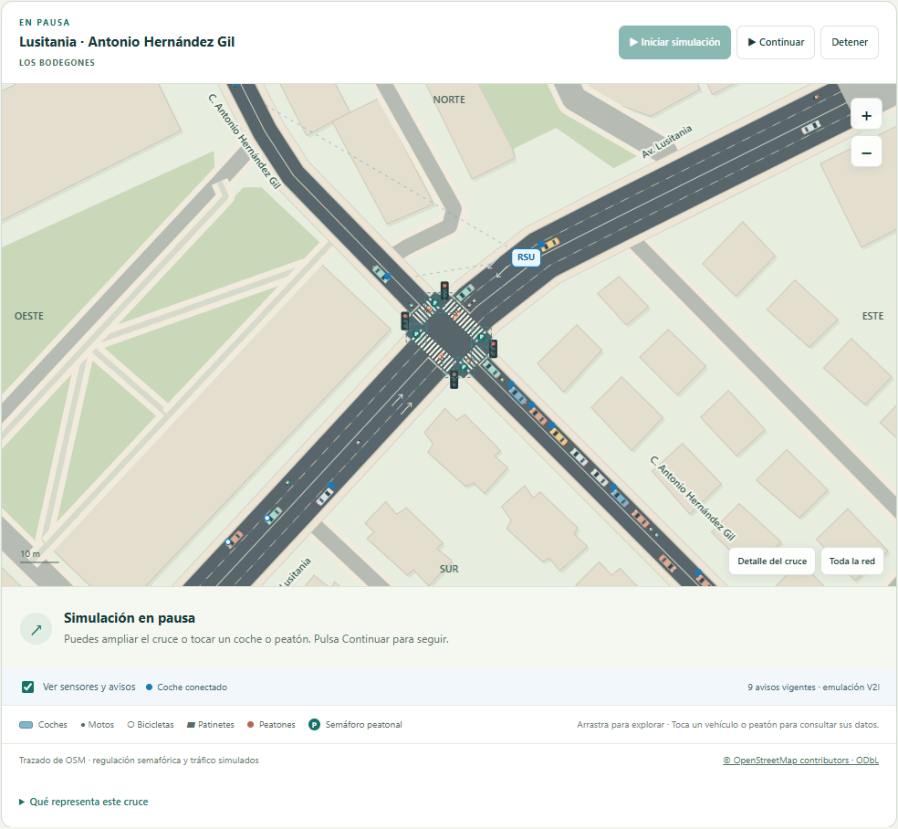
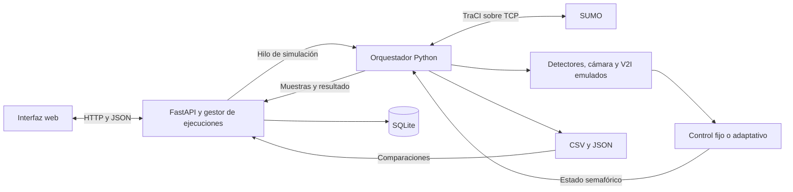
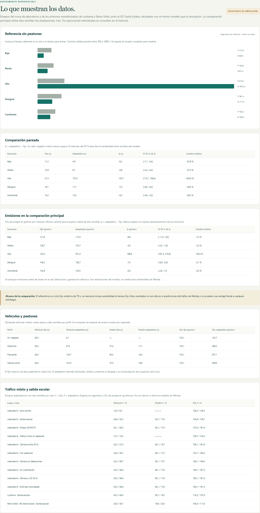
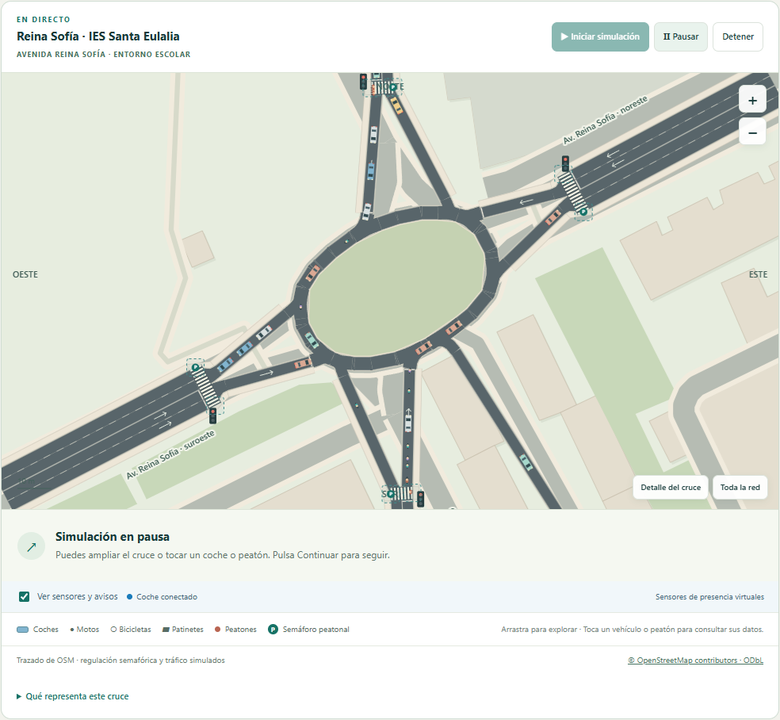

# Adaptive Traffic Light Control

**Arquitectura y simulación de un sistema ITS de control semafórico adaptativo.**
Prototipo académico que integra Python, SUMO, TraCI, FastAPI y SQLite para
observar tráfico simulado, decidir estados semafóricos y comparar estrategias
con experimentos reproducibles.



*Captura de la aplicación entregada. Cartografía © OpenStreetMap contributors,
ODbL. El tráfico, la demanda y la regulación son experimentales.*

**Ana Montero Preciado · Grado en Ingeniería Telemática en Telecomunicación ·
Universidad de Extremadura.**

## Qué problema estudia

Un plan semafórico fijo no responde a cómo cambia la demanda. Este proyecto
estudia cuándo una regulación basada en observaciones puede reducir las esperas
y qué costes introduce para otros usuarios del cruce. La comparación incluye
vehículos, peatones y CO₂ de escape estimado por SUMO.

El objetivo es construir y evaluar una cadena completa de adquisición,
comunicación, control y supervisión, conservar resultados trazables y distinguir
las mejoras de los casos en los que la estrategia adaptativa empeora el resultado.

## Funcionalidades implementadas

- Simulación de un laboratorio y dos emplazamientos de Mérida: Lusitania con
  Antonio Hernández Gil y la rotonda de Reina Sofía junto al IES Santa Eulalia.
- Control fijo y adaptativo, tiempos mínimos y máximos, amarillo, todo-rojo,
  servicio peatonal y comprobación del despeje.
- Detectores virtuales, cámara emulada y avisos V2I con participación, alcance,
  retardo, pérdidas y caducidad configurables.
- Coches, motos, bicicletas y patinetes; perfiles peatonales y demanda escolar.
- Interfaz web con vehículos y personas posicionados por SUMO, pausa, velocidad,
  zoom, selección de agentes, supervisión e informes de incidencias.
- Historial SQLite, exportación CSV y selector de 38 estudios de la memoria.
- Batería académica de **336 ejecuciones**, con agregados y resúmenes incluidos.

## Tecnologías

| Capa | Herramientas |
| --- | --- |
| Lenguaje | Python 3.12; validación realizada con 3.12.9 |
| Simulación | Eclipse SUMO 1.27.1, TraCI 1.27.1 y sumolib 1.27.1 |
| Backend | FastAPI 0.141.1, Uvicorn 0.53.0, Pydantic 2.13.5 |
| Comunicación | TraCI sobre TCP; HTTP/JSON entre navegador y API |
| Datos | SQLite, CSV y JSON |
| Interfaz | HTML, CSS, JavaScript y canvas; recursos locales |
| Análisis | NumPy, SciPy y Matplotlib |
| Calidad | pytest, Ruff y guiones Playwright |

Las versiones completas están fijadas en [requirements-lock.txt](requirements-lock.txt).
La [revisión de dependencias y atribuciones](docs/TERCEROS.md) distingue el código
del proyecto, las herramientas instaladas y la cartografía.

## Arquitectura



La API valida la configuración y permite una ejecución activa. El orquestador
avanza SUMO en pasos de un segundo, recoge observaciones y aplica las decisiones.
Un hilo permite consultar y controlar la ejecución desde la interfaz. SQLite
almacena sesiones y muestras; los lotes científicos escriben archivos separados.
La interfaz consulta estados y escenas mediante HTTP: no se implementa un enlace
radio real ni WebSocket.

Fuente editable ampliada: [arquitectura.mmd](docs/arquitectura.mmd).
Los [diagramas originales](documentacion/diagramas/drawio) conservan sus fuentes draw.io.

## Cómo decide el controlador

El controlador vehicular alterna los ejes N/S y E/O mediante una máquina de
estados. La demanda observada suma colas y aproximaciones cuando estas están
disponibles. Tras el verde mínimo, cambia si el eje contrario tiene demanda y
el actual está vacío o la diferencia supera la histéresis. El verde máximo
fuerza el cambio. Cada transición pasa por amarillo y todo-rojo.

Los valores predeterminados son 10–50 s de verde, 30 s para el fijo y el
respaldo, 3 s de amarillo, 2 s de todo-rojo e histéresis de 2 vehículos.
Si falta una observación o su antigüedad supera 5 s, el adaptativo utiliza
respaldo temporizado. No es un algoritmo de optimización global.

La extensión peatonal incorpora solicitud, fase exclusiva y despeje supervisado.
La rotonda tiene un controlador específico que conserva prioridades interiores;
no debe interpretarse como una simple aplicación del controlador de dos ejes.
El código está en [controller.py](programa/its/controller.py),
[pedestrians.py](programa/its/pedestrians.py) y [rotonda.py](programa/its/rotonda.py).

## Organización

```text
adaptive-traffic-light-control/
├── programa/
│   ├── its/                 # Control, API, adquisición, SUMO y SQLite
│   ├── web/                 # Interfaz y recursos
│   ├── tests/               # pytest y Playwright
│   ├── abrir.py             # Lanzador con detección de puerto
│   └── iniciar.py           # Servidor directo
├── simulacion/
│   ├── escenarios/          # Redes SUMO y configuración
│   └── scripts/             # Experimentos, análisis y auditorías
├── datos/
│   ├── entrada/             # Cartografía y atribución
│   └── procesados/          # Agregados, 336 resúmenes y manifiestos
├── documentacion/           # Capturas, diagramas y resultados
├── docs/                    # Auditoría, validación y portfolio
├── examples/                # Comparación breve reproducible
├── requirements.txt
├── requirements-lock.txt
└── pyproject.toml
```

`datos/sesiones`, `datos/resultados` y `datos/diagnostico` se crean al ejecutar
y se excluyen de Git. Se conservan los nombres y rutas de la entrega académica.

## Requisitos e instalación

Entorno validado: **Windows, Python 3.12 de 64 bits** y conexión para instalar
dependencias. No hacen falta dispositivos externos. Otros sistemas operativos
no se han validado en esta preparación.

Descarga o clona el repositorio y abre PowerShell en su carpeta raíz:

```powershell
python --version
python -m venv .venv
.\.venv\Scripts\python.exe -m pip install -r requirements-lock.txt
.\.venv\Scripts\python.exe -m pip check
```

Comprueba que `python --version` corresponde a Python 3.12. Si el comando no
existe, utiliza la ruta del ejecutable de tu instalación. El lanzador original
también admite `py -3.12`, pero el registro del lanzador debe estar configurado.
La instalación del archivo completo se comprobó en un entorno nuevo.

SUMO se instala mediante `eclipse-sumo`; `sumolib` localiza sus binarios.
No es necesario instalar un servidor SUMO independiente. Una instalación externa
puede utilizar `SUMO_HOME`, pero esta variante no se ha probado aquí.

## Configuración y ejecución

No se requieren secretos ni archivo `.env`. De forma predeterminada se crea
`datos/sesiones/laboratorio.sqlite3`. `ITS_DATA_DIR` permite cambiar la carpeta
de sesiones mediante una variable de entorno; no se carga automáticamente un `.env`.

```powershell
.\.venv\Scripts\python.exe programa/abrir.py --no-browser
```

Abre la dirección indicada en la consola, normalmente
[http://127.0.0.1:8765](http://127.0.0.1:8765). El lanzador busca un puerto libre
y puede reutilizar una instancia de la misma versión. Para cerrar: Ctrl+C.
También se conserva `Iniciar aplicación.cmd` como lanzador de Windows.

Para una primera simulación, selecciona Lusitania, tráfico moderado, peatones
frecuentes, dos minutos de llegadas y un control. Pulsa **Iniciar simulación**
y espera a **Completada**. El vaciado de la red continúa después de las llegadas.
Repite con la misma semilla y configuración, cambiando solo el control.
La velocidad de reproducción modifica el tiempo de visualización, no la demanda.

## Ejemplo breve desde consola

```powershell
.\.venv\Scripts\python.exe examples/simulacion_breve.py
```

Ejecuta fijo y adaptativo en el laboratorio: semilla 101, 120 s de llegadas,
20 s de calentamiento y hasta 300 s de vaciado. Comprueba la finalización,
la ausencia de colisiones y teletransportes registrados y la igualdad de demanda.
No incluye peatones ni sustituye una batería estadística.
Guarda trazas en `datos/resultados/ejemplo_breve`. Para repetir, elige una carpeta
nueva con `--output`; el ejemplo evita sobrescribir resultados existentes.

## Evaluación y resultados

| Batería | Ejecuciones |
| --- | ---: |
| Cinco demandas, diez semillas y dos controles | 100 |
| Sensibilidad al verde fijo de 20 y 40 s | 60 |
| Interrupción de observaciones | 6 |
| Cuatro perfiles peatonales | 80 |
| Detección cooperativa | 18 |
| Tráfico mixto y salida escolar | 72 |
| **Total** | **336** |

La referencia utiliza 1.800 s de llegadas y 300 s de calentamiento. Cooperación
y tráfico mixto usan 180 y 30 s. Sus resultados se analizan por separado.
Los seis ensayos largos de diagnóstico de la rotonda no forman parte de las 336
comparaciones. La [guía completa](documentacion/REPRODUCCION.md) explica las baterías.

En la comparación principal, la espera vehicular media incluye detención y
retraso de inserción. Cada fila promedia diez semillas, con igual peso:

| Demanda | Fijo (s/vehículo) | Adaptativo (s/vehículo) | Cambio |
| --- | ---: | ---: | ---: |
| bajo | 11.17 | 4.93 | -55.9% |
| medio | 12.90 | 8.10 | -37.2% |
| alto | 21.45 | 157.18 | +632.6% |
| desequilibrado | 19.13 | 11.75 | -38.6% |
| dinamico | 14.21 | 10.18 | -28.3% |

El resultado negativo con demanda alta se conserva: cambios frecuentes consumen
tiempo de despeje y reducen el tiempo útil de verde. Con peatones ocasionales,
la espera peatonal pasa de **37,45 a 17,11 s**, mientras la vehicular aumenta
de **26,30 a 67,21 s**. No se afirma una mejora universal ni simultánea para todos.

Los agregados incluyen intervalos de confianza y la definición estadística en
[comparacion.json](datos/procesados/comparacion.json). Los
[336 resúmenes](datos/procesados/resumenes_336.json) conservan métricas por ejecución.
Las auditorías de esta preparación verificaron los datos brutos originales;
no se volvieron a simular las 336 ejecuciones.



## Capturas reales

| Circulación y supervisión | Escenario escolar |
| --- | --- |
|  |  |

[Panel de supervisión](documentacion/capturas/panel_resumen.png) ·
[Telemetría V2I](documentacion/capturas/telemetria_v2i.png).
Son capturas incluidas en la entrega, no interfaces generadas. La cartografía
mostrada deriva de OpenStreetMap, con atribución ODbL. Se conservan PNG de tamaño
moderado para mantener la legibilidad, sin recomprimirlos con pérdida.

## Pruebas y reproducibilidad

```powershell
.\.venv\Scripts\python.exe -m pytest programa/tests
.\.venv\Scripts\python.exe -m ruff check programa simulacion documentacion/diagramas examples --select F
```

Las pruebas `integration` ejecutan SUMO. Consulta los resultados realmente
obtenidos y sus límites en [VALIDACION.md](docs/VALIDACION.md).
En esta preparación pasaron las 111 pruebas Python y las 102 comprobaciones
de los seis guiones de navegador.
Los guiones de navegador requieren Node.js, Playwright y un navegador;
las instrucciones originales se conservan en la guía de reproducción.

Los datos brutos masivos no se distribuyen. Para reconstruirlos y auditar todas
las baterías puede ejecutarse `simulacion/scripts/reproducir_todo.py` siguiendo
la guía. Esa ejecución completa no se repitió durante esta preparación.
Los scripts `verificar_*.py` necesitan las trazas regeneradas, no solo los agregados.

## Limitaciones y mejoras futuras

La demanda es sintética, sin calibración con aforos locales. Las geometrías
urbanas están simplificadas y la programación municipal no está reproducida.
Solo se simula un emplazamiento cada vez. No hay coordinación urbana, prioridad
de emergencias, procesamiento de vídeo real ni comunicaciones radio medidas.
El CO₂ no incluye fabricación, electricidad ni emisiones previas a la inserción.
La API es local y no dispone de autenticación para ofrecerla como servicio público.

Mejoras posibles: calibrar demanda y geometría con datos de campo, estudiar
reglas que reduzcan cambios con alta demanda, ampliar semillas en las baterías
cortas y evaluar compromisos entre peatones y vehículos. Una implantación real
exigiría validación de seguridad y comunicaciones fuera del alcance del TFG.

## Contexto académico, autoría y licencia

Trabajo Fin de Grado de **Ana Montero Preciado**, Universidad de Extremadura,
Grado en Ingeniería Telemática en Telecomunicación. La memoria de referencia
se utiliza para contrastar el proyecto; la documentación administrativa y la
memoria completa no se redistribuyen en esta preparación.

**Licencia del código pendiente de autorización de la autora.** No se ha aplicado
una licencia de software. La cartografía mantiene sus condiciones ODbL y las
dependencias sus propias licencias: [atribuciones](datos/entrada/ATRIBUCION.md)
y [recursos de terceros](docs/TERCEROS.md).
