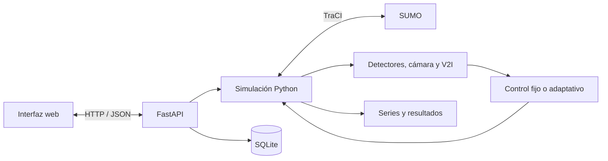
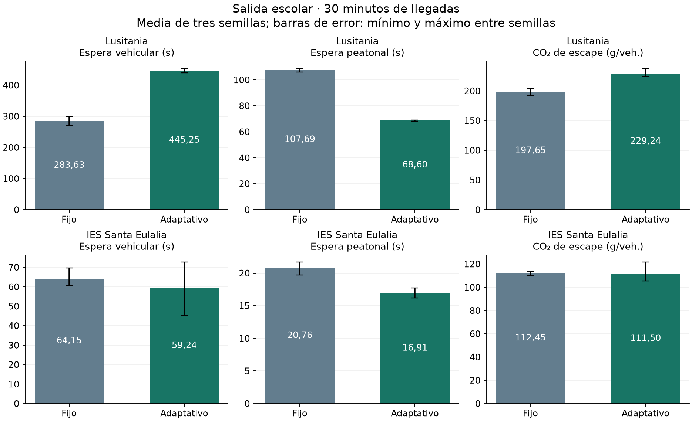

# Control semafórico adaptativo · Simulación ITS

**Comparación de semáforos fijos y adaptativos con vehículos, peatones y emisiones de CO₂.**

La aplicación simula un cruce de laboratorio y dos emplazamientos de Mérida:
Lusitania con Antonio Hernández Gil y la rotonda de Reina Sofía junto al IES
Santa Eulalia. Permite observar la circulación, ajustar la demanda y comparar
las esperas y las emisiones de escape estimadas por SUMO.

TFG de **Ingeniería Telemática**, Universidad de Extremadura · **Ana Montero Preciado**.


## Qué incluye

- **Control fijo y adaptativo:** decisiones a partir de colas, aproximaciones y solicitudes peatonales.
- **Adquisición simulada:** detectores, cámara emulada y mensajes V2I con participación, alcance, retardo y pérdidas configurables.
- **Tráfico mixto:** coches, motos, bicicletas, patinetes y diferentes perfiles peatonales.
- **Interfaz web:** vehículos y personas en movimiento, pausa, zoom y selección de agentes.
- **Resultados:** historial SQLite, exportación CSV, informes de incidencias y 40 configuraciones de estudio.

## Inicio rápido

Requisitos: **Windows y Python 3.12 de 64 bits**. La primera instalación necesita
Internet. SUMO se instala con las dependencias; no hacen falta dispositivos externos.

```powershell
git clone https://github.com/amonterooq/adaptive-traffic-light-control.git
cd adaptive-traffic-light-control
python -m venv .venv
.\.venv\Scripts\python.exe -m pip install -r requirements-lock.txt
.\.venv\Scripts\python.exe programa/abrir.py
```

También puedes descargar el ZIP, extraerlo y abrir **Iniciar aplicación.cmd**.
El lanzador prepara el entorno y abre el navegador. Si no encuentra Python,
utiliza los comandos anteriores y comprueba la versión con `python --version`.

La dirección habitual es `http://127.0.0.1:8765`. Si está ocupada, se busca otro
puerto. Mantén abierta la ventana del servidor y pulsa **Ctrl+C** para cerrarlo.
Cerrar solo el navegador no detiene la aplicación.

## Demo guiada

1. Selecciona **Lusitania**, tráfico moderado y peatones frecuentes.
2. Elige **2 minutos de llegadas**, reproducción a **5×** y control **fijo**.
3. Inicia la simulación. Puedes pausar, ampliar el cruce o seleccionar un agente
   para consultar sus datos. **Desfijar** cierra su ficha.
4. Espera a **Completada**: después de las llegadas se deja que la red se vacíe.
5. Repite con **adaptativo**, manteniendo la semilla y las demás opciones.
6. Compara ambas filas del historial y descarga sus series si quieres analizarlas.

La reproducción a 5× solo acelera la visualización. Dos minutos sirven para
observar el funcionamiento, pero no equivalen al estudio de treinta minutos.
En la demanda cambiante, los cambios están programados en los minutos 10 y 20.

El selector de estudios carga las opciones de los experimentos incluidos.
Para reproducir una media, ejecuta todas sus semillas con ambos controles.
**Comparar resultados** muestra las tablas del estudio; el historial recoge tus
ejecuciones. Si una simulación falla, **Abrir informe** muestra el motivo.

## Arquitectura y control



El **fijo** usa tiempos predefinidos. El **adaptativo** responde a la demanda
observada y a los peatones, respetando tiempos mínimos, máximos y de despeje.
Si faltan observaciones durante más de 5 s, utiliza temporización de respaldo.
La regla no optimiza directamente el CO₂: las emisiones se calculan como resultado.

En el laboratorio se alternan los ejes norte-sur y este-oeste, con fase peatonal
exclusiva. En Lusitania se alternan las entradas y se permiten peatones junto a
movimientos compatibles. Durante el verde completo del este pueden abrirse por
separado la derecha del sur y la del norte; esta última cede al recto del este.
En Santa Eulalia cada paso regula su acceso y salida de forma independiente.

Los tiempos predeterminados son 10–50 s de verde adaptativo, 30 s de verde fijo,
3 s de amarillo y al menos 2 s de todo-rojo. Las derechas auxiliares de Lusitania
se abren durante 6 s, fuera del servicio peatonal. Se comprueba el despeje antes
de abrir movimientos incompatibles. Son parámetros del modelo, no tiempos
medidos en la instalación municipal.

## Estudio y resultados

Se incluyen **348 resultados**: una batería base de 336 ejecuciones y doce
ensayos urbanos largos. Tras corregir giros y pasos peatonales, se repitieron
los 21 ensayos urbanos de la batería base; los 315 del laboratorio se mantienen.
Los agregados anteriores están en `datos/procesados/historico_v1_6`.

En el **laboratorio**, con treinta minutos de llegadas, cinco de calentamiento
y diez semillas por control, el adaptativo reduce la espera vehicular en cuatro
demandas y la aumenta con demanda alta:

| Demanda | Fijo (s/veh.) | Adaptativo (s/veh.) |
| --- | ---: | ---: |
| Baja | 11,17 | 4,93 |
| Media | 12,90 | 8,10 |
| Alta | 21,45 | 157,18 |
| Desigual | 19,13 | 11,75 |
| Cambiante | 14,21 | 10,18 |

En la **salida escolar urbana** se utiliza flota mixta, velocidades variables,
cámara y V2I al 50 %. Estas son las medias de las semillas 101, 102 y 103, con
treinta minutos de llegadas, cinco de calentamiento y vaciado de la red:

| Lugar y control | Espera vehículo (s) | Espera peatón (s) | CO₂ (g/veh.) |
| --- | ---: | ---: | ---: |
| Lusitania · fijo | 283,63 | 107,69 | 197,65 |
| Lusitania · adaptativo | 445,25 | 68,60 | 229,24 |
| Santa Eulalia · fijo | 64,15 | 20,76 | 112,45 |
| Santa Eulalia · adaptativo | 59,24 | 16,91 | 111,50 |

En Lusitania el adaptativo reduce la espera peatonal un 36,30 %, pero aumenta
la vehicular un 56,99 % y el CO₂ un 15,98 %. En Santa Eulalia disminuyen las tres
medias, aunque el cambio en CO₂ es pequeño: 0,84 %. Por tanto, **la demanda alta
no es el único caso desfavorable**: también influyen los movimientos permitidos
y el reparto de tiempo entre vehículos y peatones.

La demanda es sintética y no está calibrada con aforos locales. Tres semillas
permiten explorar los casos urbanos, sin demostrar una mejora general. La espera
incluye detención y retraso de inserción; el CO₂ solo contabiliza escape dentro
de la red. Estas cifras no son mediciones del tráfico real de Mérida.

[Resultados del laboratorio](datos/procesados/comparacion.json) ·
[Resultados urbanos](datos/procesados/movimientos_30min.json) ·
[Cambios respecto al control anterior](datos/procesados/cambios_control.csv)

<details>
<summary>Gráfica y reproducción de los experimentos</summary>



Los ensayos cooperativos y mixtos cortos usan 180 s de llegadas y 30 s de
calentamiento. Se analizan por separado de los ensayos largos. Las 33 ejecuciones
urbanas de la revisión terminaron sin colisiones, teletransportes ni conflictos
peatonales registrados; sus esperas y emisiones se contrastaron con los viajes de SUMO.

Para repetir esos 33 ensayos y generar sus tablas y figuras:

```powershell
.\.venv\Scripts\python.exe simulacion/scripts/actualizar_estudio_movimientos.py --workers 3
.\.venv\Scripts\python.exe simulacion/scripts/analizar_movimientos.py
```

El primer script valida resultados existentes para esa versión del motor o
ejecuta los que faltan. Una ejecución incompleta produce un aviso de error.
Para reconstruir toda la batería base, ejecuta antes
`simulacion/scripts/reproducir_todo.py`. Las trazas se guardan en `datos/resultados`;
son necesarias para los scripts `verificar_*.py` y no se distribuyen en Git.

`examples/simulacion_breve.py` compara ambos controles durante 120 s en el
laboratorio. `examples/comparar_movimientos.py` ejecuta las doce comparaciones
escolares largas. Ambos aceptan `--output` para guardar otra ejecución.

</details>

## Pruebas

```powershell
.\.venv\Scripts\python.exe -m pytest programa/tests
.\.venv\Scripts\python.exe -m ruff check programa simulacion documentacion/diagramas examples --select F
```

La última batería completa terminó con **128 pruebas aprobadas**. Comprueba
controladores, API, almacenamiento, resultados e integración con SUMO.
Las pruebas que ejecutan SUMO llevan la marca `integration` de pytest.

<details>
<summary>Pruebas de navegador con Edge y Playwright</summary>

Requieren Node.js y Edge. Inicia el servidor con un historial de pruebas:

```powershell
$env:ITS_DATA_DIR = Join-Path $env:TEMP 'tfg-pruebas'
.\.venv\Scripts\python.exe programa/abrir.py --port 8795 --no-browser
```

En otra ventana de PowerShell, desde la misma carpeta:

```powershell
npm install --prefix programa/tests
$env:ITS_BROWSER = 'msedge'
$env:ITS_URL = 'http://127.0.0.1:8795'
$env:ITS_SCREENSHOTS = Join-Path $env:TEMP 'tfg-capturas'
node programa/tests/browser_derechas.cjs
node programa/tests/browser_estudios.cjs
```

Usa el puerto indicado por el servidor. Estos guiones comprueban los giros,
las 40 configuraciones de estudio, la coincidencia entre formulario y lote,
las tablas, los informes de incidencias y la vista móvil. Los demás guiones
`browser*.cjs` están en esa carpeta y se ejecutan de forma secuencial.

</details>

## Estructura

```text
programa/
  its/           Controladores, adquisición, SUMO, API y SQLite
  web/           Interfaz y recursos visuales
  tests/         Pruebas Python y de navegador
simulacion/      Redes SUMO y scripts de experimentación
datos/
  entrada/       Geometrías y contexto de los emplazamientos
  procesados/    Resúmenes, agregados e histórico
documentacion/   Capturas, diagramas editables, tablas y gráficos
examples/        Ejemplos de ejecución desde consola
```

Las sesiones se guardan en `datos/sesiones/laboratorio.sqlite3`; `ITS_DATA_DIR`
permite cambiar la carpeta. Las sesiones, diagnósticos, trazas y el entorno
`.venv` son archivos locales excluidos de Git.

## Licencia y recursos

Código y documentación de software bajo [MIT](LICENSE). Las dependencias
conservan sus propias licencias. La imagen del acueducto es propia.

Cartografía y redes derivadas: **© OpenStreetMap contributors**, bajo
[ODbL 1.0](https://opendatacommons.org/licenses/odbl/1-0/) y sus
[condiciones de atribución](https://www.openstreetmap.org/copyright).
Se utilizan extractos del [entorno de Mérida](https://api.openstreetmap.org/api/0.6/map?bbox=-6.350,38.912,-6.328,38.927),
[Lusitania](https://api.openstreetmap.org/api/0.6/map?bbox=-6.344,38.906,-6.329,38.914)
y [Santa Eulalia](https://api.openstreetmap.org/api/0.6/map?bbox=-6.344,38.906,-6.329,38.916),
con geometrías simplificadas y parámetros operativos supuestos. El contexto
municipal procede del INE y del PMUS; no genera las llegadas sintéticas.

MIT no sustituye la licencia cartográfica ni concede una licencia general sobre
los recursos visuales. Las capturas muestran la aplicación; las de informes de
incidencias utilizan respuestas de fallo simuladas. Los resultados experimentales
se incluyen para consulta y reproducción.
