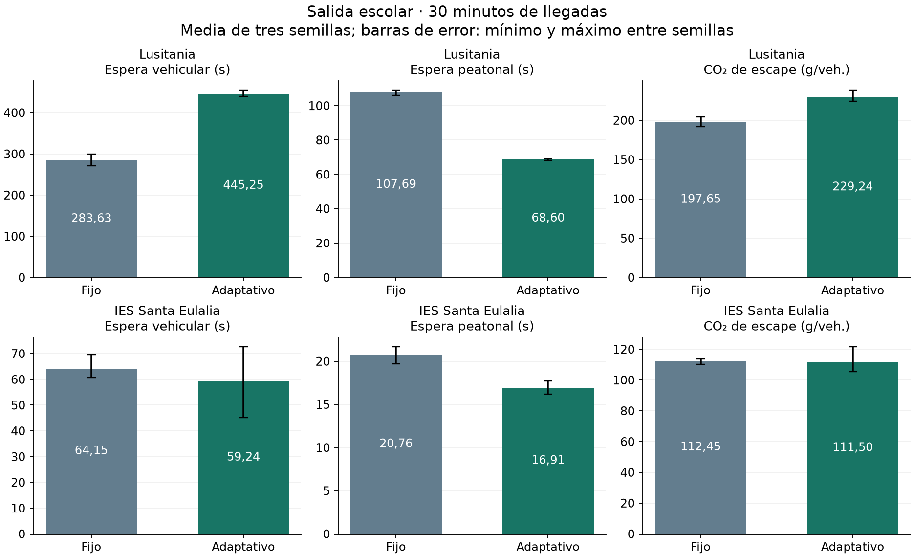

# Estudio actualizado del control semafórico

Versión 1.7.1 · 2026-11-24

## Alcance de la revisión

Se mantienen los objetivos, la arquitectura ITS y el estudio del laboratorio. La corrección afecta a la regulación de Lusitania y Santa Eulalia. Se han vuelto a ejecutar **21 de los 336 ensayos**: nueve de adquisición cooperativa en Lusitania y doce de salida escolar en los dos emplazamientos. Los **315 ensayos de laboratorio** conservan exactamente sus resúmenes anteriores. Se añaden doce ensayos de treinta minutos, por lo que el estudio actual reúne **348 resultados**, de los cuales 33 se han ejecutado en esta revisión.

La memoria presentada no se reescribe. Los agregados originales se conservan en `datos/procesados/historico_v1_6`; el código anterior está en el commit `70f537a91d152af75ee40d79fe07a80c77a070e4`. Los agregados principales del repositorio y las tablas de la aplicación corresponden al programa actual.

## Qué cambia en el control

En Lusitania, una entrada permite recto e izquierda a la vez, además de derecha. Durante el turno completo del este pueden abrirse, por separado, las derechas del sur y del norte. Se emplean aperturas de seis segundos, amarillo y un despeje mínimo de dos segundos, prolongado si aún queda un vehículo de la apertura anterior. La derecha del norte cede al movimiento recto del este porque comparten salida. El turno adaptativo puede acabar antes de que se atiendan las dos aperturas; no se fuerza su duración para abrirlas siempre. Estos tiempos son hipótesis experimentales, no tiempos medidos en Mérida.

Los pasos peatonales se atienden individualmente junto con movimientos compatibles. Durante su servicio no se habilitan las derechas adicionales. En Santa Eulalia cada paso cierra únicamente su acceso y su salida. El laboratorio conserva su fase peatonal exclusiva. Las relaciones de cesión se han recalculado con netconvert, como indica la [documentación de SUMO](https://sumo.dlr.de/docs/Simulation/Traffic_Lights.html#interaction_between_signal_plans_and_right-of-way_rules).

## Comparación con los resultados anteriores

Para aislar el cambio de regulación se conservan duración, calentamiento, semillas, demanda, flota y reparto de giros. Se han comprobado las huellas de esas entradas y se han recalculado las esperas y el CO₂ a partir de los viajes de SUMO. Las tablas siguientes promedian las semillas 101, 102 y 103 con igual peso.

### Salida escolar corta: 180 s de llegadas y 30 s de calentamiento

| Lugar y control | Espera vehicular anterior → actual (s) | Espera peatonal anterior → actual (s) | CO₂ anterior → actual (g/veh.) |
| --- | ---: | ---: | ---: |
| Lusitania · fijo | 45,32 → 104,62 | 50,75 → 78,99 | 116,17 → 188,06 |
| Lusitania · adaptativo | 40,61 → 109,87 | 19,20 → 42,92 | 107,04 → 194,52 |
| IES Santa Eulalia · fijo | 25,84 → 19,36 | 19,64 → 18,22 | 105,35 → 93,55 |
| IES Santa Eulalia · adaptativo | 30,71 → 24,32 | 20,49 → 14,34 | 111,65 → 103,95 |

### Adquisición cooperativa en Lusitania: 180 s de llegadas

Control adaptativo, peatones frecuentes y 30 s de calentamiento. Estos casos no representan la salida escolar de la tabla anterior.

| Adquisición | Espera vehicular anterior → actual (s) | Espera peatonal anterior → actual (s) | CO₂ anterior → actual (g/veh.) |
| --- | ---: | ---: | ---: |
| Sensores | 65,76 → 108,18 | 21,48 → 69,94 | 168,25 → 209,66 |
| V2I 50 % | 61,82 → 102,25 | 19,60 → 73,87 | 161,94 → 202,74 |
| V2I 100 % | 65,04 → 99,86 | 22,91 → 73,87 | 165,32 → 198,71 |

## Comprobación de treinta minutos

Se comparan fijo y adaptativo con salida escolar, flota mixta, velocidades variables, cámara emulada y V2I al 50 %. Cada ensayo incluye 1800 s de llegadas, 300 s de calentamiento y vaciado de la red. La semilla es la misma dentro de cada pareja. Las doce ejecuciones han completado los viajes de vehículos y peatones sin colisiones, teletransportes ni conflictos peatonales registrados.

| Lugar | Vehículo fijo / adaptativo (s) | Peatón fijo / adaptativo (s) | CO₂ fijo / adaptativo (g/veh.) |
| --- | ---: | ---: | ---: |
| Lusitania | 283,63 / 445,25 | 107,69 / 68,60 | 197,65 / 229,24 |
| IES Santa Eulalia | 64,15 / 59,24 | 20,76 / 16,91 | 112,45 / 111,50 |



## Interpretación

En **Lusitania**, el control adaptativo aumenta la espera vehicular un 56,99 %, disminuye la espera peatonal un 36,30 % y aumenta el CO₂ de escape por vehículo un 15,98 % respecto al fijo, dentro de esta configuración escolar de treinta minutos.

En **IES Santa Eulalia**, el control adaptativo disminuye la espera vehicular un 7,66 %, disminuye la espera peatonal un 18,55 % y disminuye el CO₂ de escape por vehículo un 0,84 % respecto al fijo, dentro de esta configuración escolar de treinta minutos.

La corrección es relevante para las cifras urbanas: cambiar movimientos simultáneos y atención peatonal cambia la capacidad y el reparto de esperas. No invalida las comparaciones del laboratorio, pero impide utilizar las cifras urbanas antiguas para describir el código nuevo. Tampoco demuestra que el control adaptativo reduzca siempre las emisiones. La regla utiliza demanda y solicitudes, no optimiza directamente el CO₂.

Las pruebas cortas y largas responden a duraciones distintas y no se mezclan en una misma media. Tres semillas permiten una exploración, pero no una conclusión estadística general ni una estimación del tráfico real de Mérida. El CO₂ mide emisiones de escape dentro de la red; no incluye emisiones durante el retraso previo a la inserción, fabricación o electricidad. La espera vehicular sí incorpora ese retraso de inserción.

## Reproducción y archivos

```powershell
.\.venv\Scripts\python.exe simulacion/scripts/actualizar_estudio_movimientos.py --workers 3
.\.venv\Scripts\python.exe simulacion/scripts/analizar_movimientos.py
```

El primer script verifica o ejecuta los 33 ensayos de esta revisión y conserva los 315 resultados del laboratorio. Guarda cada ejecución bajo una carpeta identificada por el código del motor y sus redes para evitar reutilizar resultados de una lógica distinta. Los viajes masivos se generan localmente; el repositorio incluye configuraciones, resúmenes, CSV y figuras. En la aplicación, los dos estudios largos están en «7. Revisión urbana · treinta minutos».

- [Resultados cortos y cambios respecto al plan anterior](../datos/procesados/cambios_control.csv).
- [Doce ensayos largos, configuraciones y resúmenes](../datos/procesados/movimientos_30min.json).
- [Medias y rango entre semillas](../datos/procesados/movimientos_30min.csv).
- [Comprobación de la revisión](../datos/procesados/revision_estudio.json).
