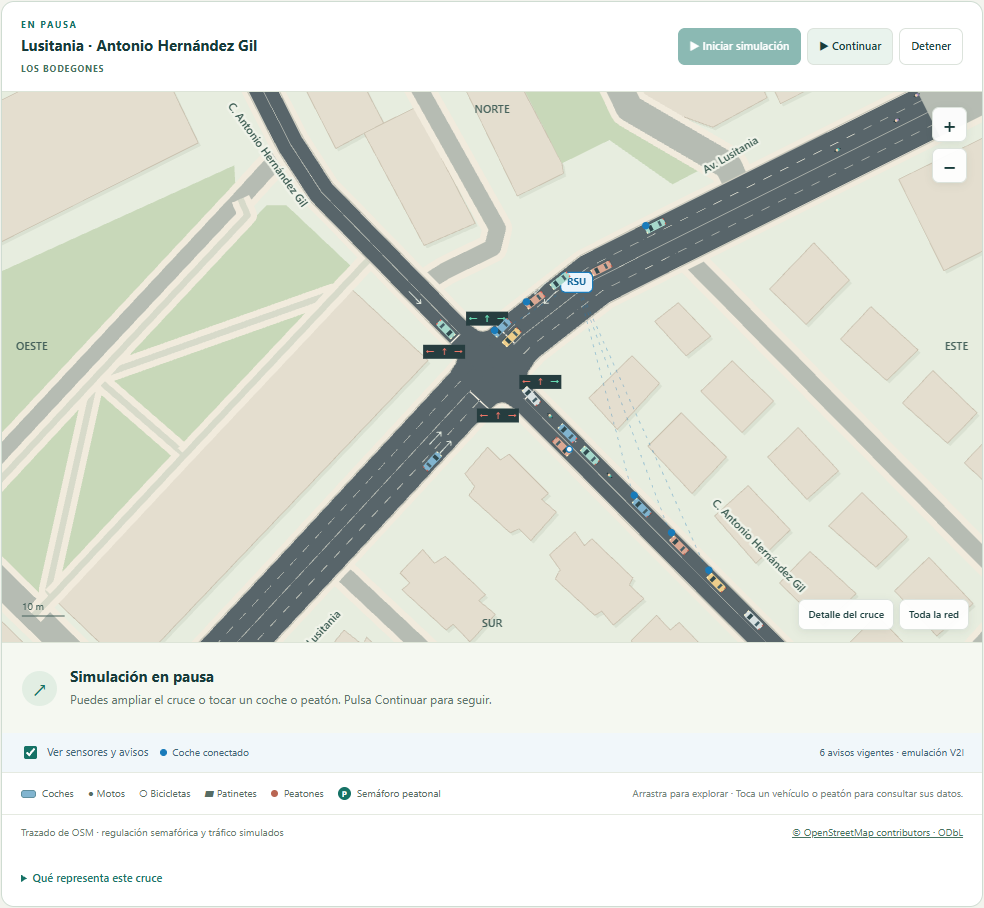
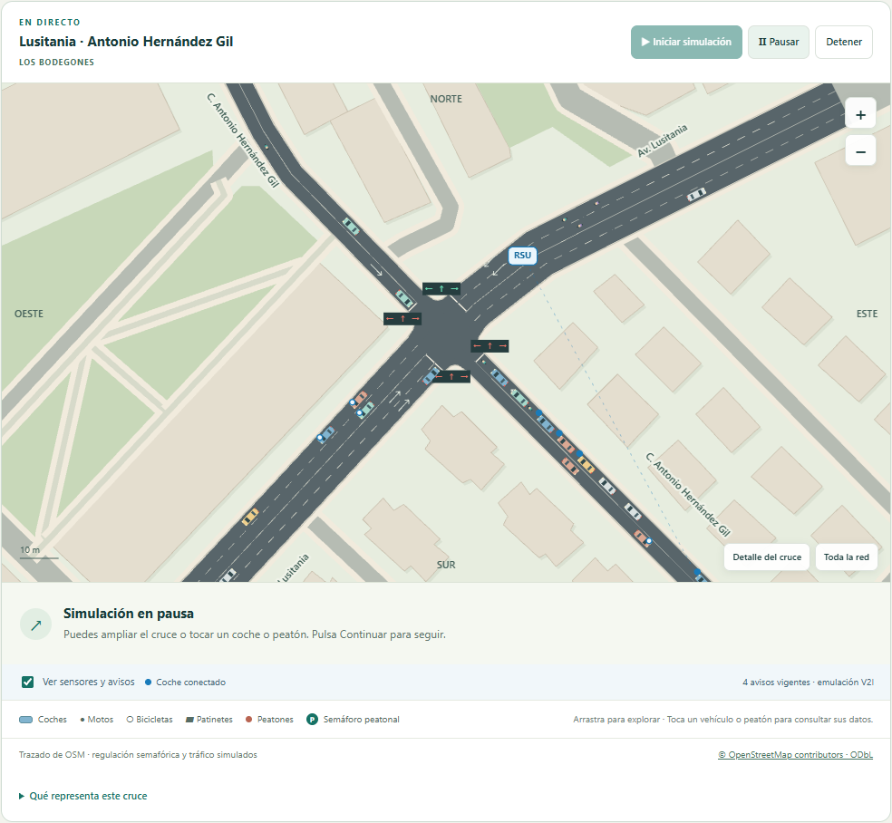
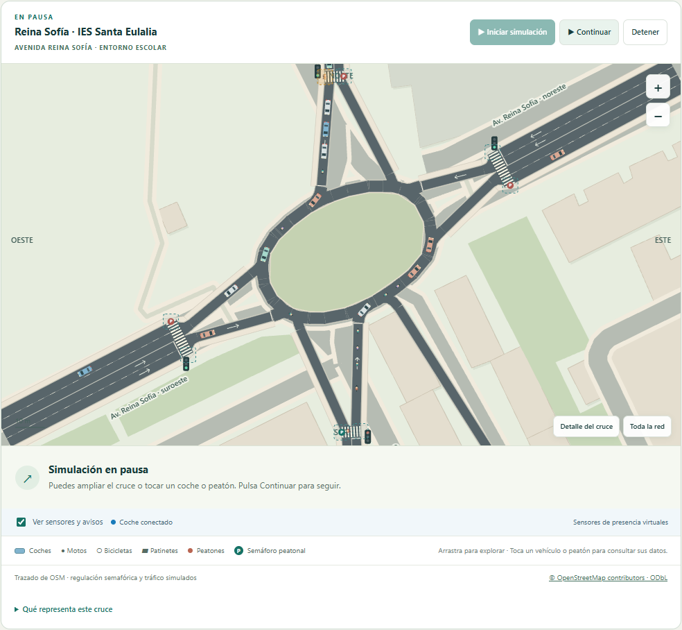

# Revisión de giros y pasos peatonales

24 de noviembre de 2026 · versión 1.7.1.

## Lusitania

El control alterna las entradas N, E, S y O. Cada turno completo permite recto,
izquierda y derecha de la entrada principal. Durante el verde completo del este
se abre primero la derecha del sur durante 6 s, pasa por amarillo y espera al
menos 2 s y la salida del último vehículo de ese movimiento. Después puede
abrirse la derecha del norte durante 6 s. Ambas aperturas son independientes;
recto e izquierda de esas entradas siguen cerrados. El este conserva sus tres
movimientos mientras se realizan estas aperturas. Si su turno termina antes,
la derecha auxiliar también se cierra pasando por amarillo.

La derecha del norte comparte salida con el recto del este: tiene permiso con
cesión (`g` en SUMO), mientras el este conserva prioridad (`G`). Se recalcularon
las relaciones de prioridad de la red con netconvert y se comprobó la cesión
frente a ambos carriles rectos del este. En la interfaz se indica «verde (ceder)».
Solo se añade esta combinación durante el turno del este; no se extrapola a
las demás entradas sin conocer sus movimientos. Los tiempos son hipótesis
experimentales, no mediciones de los semáforos municipales.

Las solicitudes peatonales se registran por paso. Al comenzar el siguiente
turno se atiende la más antigua que tenga movimientos compatibles con la
entrada. Durante 10 s se permite iniciar el cruce; después se dejan al menos
15 s de despeje y se comprueba que no quede ninguna persona cruzando. Los
movimientos incompatibles permanecen cerrados hasta entonces. Las aperturas
auxiliares de derecha se reservan para el verde vehicular completo, posterior
al servicio peatonal. Entre entradas hay amarillo, todo-rojo y comprobación de
vaciado del cruce, incluidos los vehículos lentos.

Las compatibilidades excluyen los pasos de origen y destino del vehículo y
los conflictos adicionales de la matriz de SUMO. Compartir carril puede hacer
que un coche cuyo giro está cerrado retenga a otros. Se conserva la geometría
del modelo, sin añadir carriles exclusivos para evitar esa retención.

| Este con derecha del sur | Este con derecha del norte y cesión |
| --- | --- |
|  |  |

## Santa Eulalia y laboratorio

En Santa Eulalia, cada paso atiende su solicitud cerrando su entrada y su
salida. Los otros accesos siguen funcionando y se conserva la prioridad del
anillo. El laboratorio conserva las fases utilizadas en la batería de referencia.
Las regulaciones urbanas son propuestas de simulación; no se han verificado
las flechas ni los tiempos de las instalaciones municipales.

## Estudio y validación

El [estudio actualizado](ESTUDIO_ACTUALIZADO.md) sustituye las cifras urbanas
del repositorio: 21 ensayos recalculados, 315 resúmenes de laboratorio conservados
y doce ensayos urbanos adicionales de treinta minutos. Las 33 ejecuciones de
esta revisión finalizaron conservando todos los viajes, sin colisiones,
teletransportes ni conflictos peatonales registrados. Las esperas y emisiones
se contrastaron con los viajes de SUMO y se verificó que las entradas de los
21 ensayos repetidos coinciden con las de la entrega anterior.

La memoria presentada permanece intacta. Los agregados anteriores están en
`datos/procesados/historico_v1_6`; no se utilizan como resultados del control nuevo.

La batería Python completa terminó con **128 pruebas aprobadas**, sin fallos,
en 408,75 s. Persisten dos avisos de obsolescencia de Starlette/httpx y AnyIO.
Incluye control, integración SUMO, almacenamiento, API y coherencia del estudio.

Comprobaciones de interfaz con Edge y Playwright:

- Ocho comprobaciones del guion `browser_derechas.cjs`: permisos del este,
  derechas separadas, cesión del norte, cierre de los otros movimientos,
  ejecución sin incidentes, separación de tablas, vista móvil y errores JavaScript.
- Nueve comprobaciones de `browser_estudios.cjs`: carga de las 40 configuraciones,
  referencia individual, adaptación a móvil, bloqueo de cambios durante una
  ejecución, reproducción del resultado incluido, historial, tabla ambiental,
  informe de incidencias y ausencia de errores JavaScript.
- El ensayo lanzado desde el formulario coincide con el lote de laboratorio
  en espera, CO₂, colas, demanda, flota y número de vehículos.
- Ruff y sintaxis JavaScript sin errores.

Estas comprobaciones validan los casos simulados; no certifican una instalación real.
